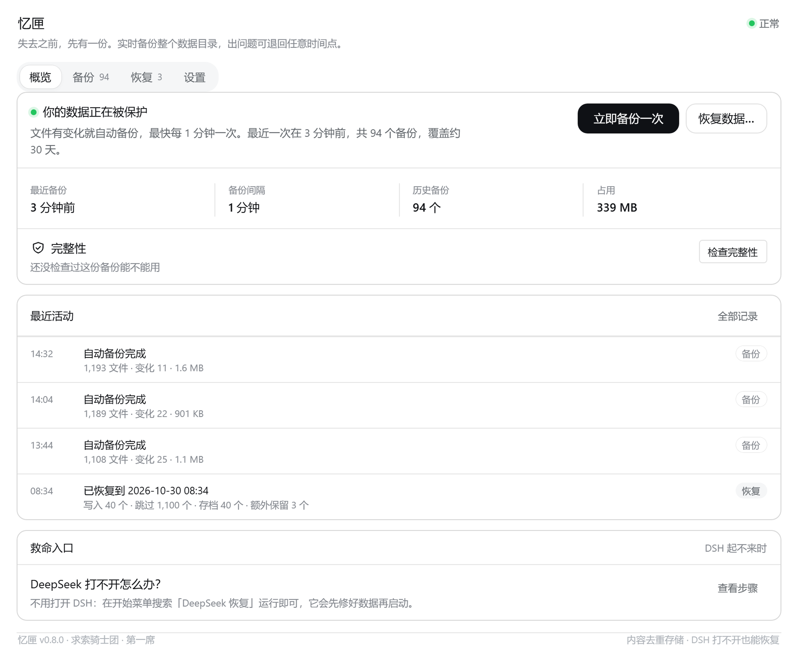

# 忆匣 / Casket

> DeepSeek Harness 的灾备插件：**实时快照整个 `DSH_HOME`，出问题时一键恢复。**
> 失去之前，先有一份。



## 这是什么

DSH 把会话、工作区、设置、插件、凭据、记忆库全部沉淀在 `DSH_HOME` 一个目录里。这个目录一旦被清空，丢的不是文件，是「那段时间里发生过什么」的唯一原件。

忆匣只做一件事：**把任意一个时刻的全库状态，原样封存并可原样取回。**

- 不做语义恢复，找不回「三月那句话」；不检索、不联想、不解释——**匣里没有故事，只有原件**。
- 不替你决定恢复哪一份，只列候选与时间。
- 不横向搬设备（那是同步插件的事）。

## 能力

| 能力 | 说明 |
|---|---|
| **实时封存** | `fs.watch` 递归监听 + 9 s 合并窗口 + 两次快照最小间隔 60 s；首次全量 110 MB / 1,156 文件约 2.5 秒 |
| **分块内容寻址** | 默认 64 KiB 分块，同样的内容只存一份；追加型日志只新增尾块（早期版本每 10 秒重存 2.3 MB，一小时 800 MB） |
| **多层保留** | 最近 60 份 + 48 小时内每小时 1 份 + 30 天内每天 1 份，硬上限 100 份（超出从最旧回收） |
| **恢复不删东西** | 恢复前先给当前状态拍 `pre-restore` 快照；被覆盖文件进 `restore-quarantine`；快照里没有的新文件原地保留；清单缺块 → 直接拒绝，不写半份数据 |
| **DSH 起不来也能救** | 桌面/开始菜单「Deepseek恢复」外部控制台（装在 `%LOCALAPPDATA%`，不在 `.dsh` 里）+ 零依赖 Node 的 `recovery-kit` |
| **异地加密副本** | 每天一份已验证快照 → scrypt(N=2¹⁷) 派生密钥 → AES-256-GCM 分块加密 → 块级去重同步到子机；子机只存密文、不解密、不存密码 |
| **事故留证** | 黑匣子每 5 秒写心跳；外部看门狗每分钟检查（独立计划任务）；异常退出 / 卡死 / 数据骤降 / 覆写 / 备份损坏 / 异地过期 / 磁盘不足；事故成立即暂停自动备份并钉住推荐恢复点 |

## 安装

```powershell
git clone https://github.com/YarXVI/dsh-disaster-recovery.git
cd dsh-disaster-recovery
powershell -NoProfile -ExecutionPolicy Bypass -File .\scripts\install.ps1 -Apply
```

安装会做四件事：把插件装进 profile、把不依赖 DSH 的恢复工具复制到 `%LOCALAPPDATA%\DeepSeek Recovery`、创建「Deepseek恢复」快捷方式、打印后续操作。装完重启 DSH，左侧栏出现「忆匣」。

**从插件市场安装（推荐，不需要 git）**

在 DSH 里：**插件 → 实验性插件旁「更多」→ 打开「自定义插件市场」→ 发现 → 添加索引源**，填入：

```
https://yarxvi.github.io/dsh-plugin-dsh-sync/market/index.json
```

搜索「忆匣 / Casket」安装；也可以直接用 npm 源：

```powershell
dsh plugin --profile web add dsh-disaster-recovery@0.8.0
```

## 三步上手

1. 重启 DSH → 左侧栏「忆匣」→ 概览显示「你的数据正在被保护」
2. 点「检查完整性」——确认这份备份真的能用（**没检查过，它不会说「内容完整」**）
3. 点「立即备份一次」

之后它自己跑，最快每 60 秒一次。恢复后必须**完全退出并重启 DSH**（DSH 的内存态会把它自己的旧状态写回去）。

## 安全边界

- 只读 `DSH_HOME`；写入只发生在备份根目录与恢复时。
- 备份根目录必须在 `DSH_HOME` 之外（默认 `D:\dsh-backup`）——这是唯一能对抗「home 被清空」的布局。
- 清单路径经 `joinInside()` 校验，`..` 与绝对路径一律拒绝；快照 id 与块哈希走白名单正则。
- 恢复时若缺内容块，**拒绝恢复**，不写半份数据。
- 面板只允许本机回环访问；CLI 不需要网络。
- 异地副本的密码永不出本机：面板与 CLI 都不会把密码、明文、文件名发给子机；子机只按 id 提供密文字节。**密码丢失 = 数据不可读，没有后门。**

## 已知限制

- `fs.watch` 递归在部分网络盘/极旧 Windows 上不可靠 → 自动退回 `scanMs` 轮询。
- 恢复不删除「快照里没有、但现在存在」的文件（有意为之，只在报告里给数量）。
- 只备份 `DSH_HOME`；DSH 安装目录不在范围内（重装即可）。
- 恢复判据是「大小 + mtime」：文件被改成同样大小且 mtime 未变（几乎不可能）会被当成未变化。
- 两次快照之间写入又丢失的内容，救不回。

## 开发

```powershell
node --test --test-isolation=none "test/*.test.mjs"   # 179 项 Host 测试
powershell -File scripts/drill.ps1                    # 临时目录里跑一遍备份→删→恢复→校验
```

零运行时依赖，Node ≥ 20。

## 许可证

[MIT](LICENSE)。可自由使用、修改、分发，保留版权与许可声明。

## 相关

- DSH 插件市场索引：`dshopen.org`、`dshmarket.com`、`dshpluginleaderboard.com`
- 同一位作者的其他席位：浮桥（设备同步）、燧心（本机推理）、棱镜（记忆分层）
